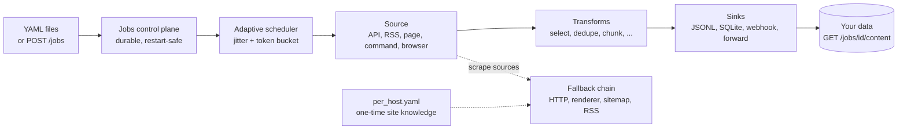

<h1 align="center">ujin</h1>

<p align="center"><b>Point it at the web with YAML. Get clean data back.</b><br>
A config-driven scraper platform: scheduling, politeness, fallbacks and delivery are
handled for you, and you never edit ujin's code to aim it at something new.</p>

<p align="center">
  
  
  
  
</p>

## The problem, and the answer

Scraping real sites is rarely "fetch a URL". Every new target brings the same chores,
and the usual fix is another one-off script.

| The usual pain | What ujin does instead |
|---|---|
| A new source means a new script | One YAML file per source: **source → transforms → sinks → schedule** |
| Fixed intervals hammer quiet sites and miss fast ones | The interval **adapts**: backs off when nothing changes, speeds up when it does, retreats on 429s |
| Every site is a special case in your code | A per-host config pins a strategy, a feed or sitemap URL, or selectors, once |
| One blocked fetch and you get nothing | A fallback chain: HTTP → headless renderer → sitemap → RSS |
| Typos surface at 3 a.m. | `ujin validate` reports `file:line` errors before you deploy |
| Results end up scattered | Sinks (JSONL, SQLite, webhooks, forward) and `GET /jobs/{id}/content` |



```yaml
# workflows/crossref.yaml: one file is one job, the filename is its id
source:
  kind: api
  config:
    url: https://api.crossref.org/works?query=quantum&rows=50
    json_path: message.items
transforms:
  - {kind: select, config: {where: {type: journal-article}, fields: [DOI, title]}}
  - {kind: dedupe, config: {key: DOI}}
sinks:
  - {kind: jsonl, config: {path: /data/crossref.jsonl}}
schedule: {mode: adaptive, base: 3600, min: 600, max: 86400}
```

Drop that file in `./workflows`, run `docker compose up`, and the latest data is
at `GET /jobs/crossref/content`. Check a file before you deploy it with
`ujin validate workflows/` (errors come back as `file:line: message`).

## What it does

ujin is two halves that share one toolkit:

| | |
|---|---|
| **Adaptive poller** | Polls HTTP pages, RSS, JSON APIs, GraphQL, shell commands, Python callables, page regions and browser recipes. The interval **adapts** (backs off when nothing changes, speeds up when it does, retreats on 429s), with **jitter** and a global token bucket so load stays smooth. |
| **Scrape service** | One-shot fetch and extraction with an HTTP → headless renderer → sitemap → RSS fallback chain, per-host cooldown and change fingerprints. Extracts links, articles, structured data, tables, images, metadata, feeds and contacts behind a small HTTP API. |

On top sits a **jobs control plane**: *source → transforms → sinks → schedule*,
durable across restarts, configured by YAML files or REST, extensible with
Python plugins when the built-ins aren't enough.

## Quick start

**Container (recommended)**

```bash
docker compose up --build        # poller :8900 · scrape :8901 · jobs :8902
curl localhost:8901/health
curl -X POST localhost:8901/scrape -H 'content-type: application/json' \
  -d '{"url":"https://example.com","mode":"structured"}'
```

Mount points: `./workflows` (one YAML per job), `./plugins` (drop-in Python), and a
named volume for the job store. The default image is pure Python and builds in
seconds. Variants: `ujin-browser` (Playwright/Chromium, ~1.5 GB) and `ujin-full`
(adds the obscura headless renderer; the first build compiles V8, ~15–20 min).

**Local**

```bash
pip install -e ".[web]"
ujin doctor                  # what's installed, and what each backend unlocks
ujin init                    # writes a commented starter targets.yaml
ujin sweep targets.yaml      # poll once, print what changed
```

## Configure it, don't code it

| You want | You write |
|---|---|
| Poll a source on a schedule, filter it, send it somewhere | a workflow file in `./workflows` ([docs/WORKFLOWS.md](docs/WORKFLOWS.md)) |
| Share boilerplate across jobs | `defaults:` and `include:` fragments |
| One template, many jobs | `matrix:` fan-out (list of variable maps, or cartesian axes) |
| A whole batch from one file | an ingest plan, `ujin jobs-serve --plan` ([docs/INGEST_PLAN.md](docs/INGEST_PLAN.md)) |
| Tell ujin how one site behaves | `per_host.yaml`: pin a strategy, a feed or sitemap URL, or CSS selectors for a host |
| Create jobs at runtime | `POST /jobs` ([docs/JOBS.md](docs/JOBS.md)) |
| Something the built-ins don't cover | a Python file in `./plugins` ([docs/PLUGINS.md](docs/PLUGINS.md)) |
| Use it from an agent | `ujin mcp-serve` ([docs/MCP.md](docs/MCP.md)) |

**Validate before you deploy.** `ujin validate PATH...` loads files through the
same resolver the server uses (defaults, includes, matrix and templates included),
checks every source, transform and sink kind, and reports `file:line` errors. For
editor completion, `ujin validate --print-schema` emits the JSON Schema committed
at [docs/schema/workflow.schema.json](docs/schema/workflow.schema.json).

**Per-host tuning is also config.** Sites differ: one has a clean feed, one is
bot-walled, one needs a renderer. A `per_host.yaml` (set `PER_HOST_CONFIG_PATH`)
records that once per host:

```yaml
hosts:
  npr.org:
    strategy: auto
    rss_url: https://feeds.npr.org/1001/rss.xml   # combined mode uses this feed
```

## The scrape API

```bash
# links, several extractors over one fetch, or many URLs concurrently
curl -X POST localhost:8901/scrape -H 'content-type: application/json' \
  -d '{"url":"https://example.com","modes":["links","structured","tables","metadata"]}'
curl -X POST localhost:8901/scrape -H 'content-type: application/json' \
  -d '{"urls":["https://a.example","https://b.example"],"mode":"links"}'

# a feed, parsed; dates are ISO-8601 UTC
curl -X POST localhost:8901/feed -H 'content-type: application/json' \
  -d '{"url":"https://feeds.bbci.co.uk/news/world/rss.xml"}'
```

`mode=combined` fetches a homepage and its feed in parallel and merges them. When
a feed is pinned, the feed's items are returned even if the homepage is slow or
bot-walled (`UJIN_COMBINED_HTML_TIMEOUT_SECS`, default 10).

Modes: `links · article · auto · combined · structured · tables · images · metadata · feeds · contacts`.
Also `/scrape:batch`, `/sitemap`, `/discover`, `/capabilities`, `/metrics`, and
optional `/social/*` and `/trends/*`. Interactive docs are at `/docs` on each
service; the full reference is [docs/API.md](docs/API.md).

Set `UJIN_API_KEY` to require `X-API-Key` or Bearer auth everywhere (`/health`
stays open).

## Poller as a library

```python
from ujin import PollEngine, HttpPollable, CommandPollable, CallablePollable

engine = PollEngine(adaptive=True, site_store_path="state.db")  # learned pacing, survives restarts
engine.add(HttpPollable("https://example.com"), base=300, on_change=on_change)
engine.add(CommandPollable(["git", "ls-remote", url]), base=600)
engine.add(CallablePollable(lambda: db.count(), key="rows"), base=30)

await engine.run()                 # daemon: adaptive + jittered
# results = await engine.sweep()   # or one pass, cron-friendly
```

Opt-in `respect_robots=True` honors `Crawl-delay` and skips disallowed paths.
Details: [docs/ADAPTIVE.md](docs/ADAPTIVE.md), [docs/ROBOTS.md](docs/ROBOTS.md).

Other things worth knowing about: page-region change watching
(`ujin watch URL --selector main --webhook …`), browser recipes that click
"Load more" until a list is exhausted ([docs/BROWSER.md](docs/BROWSER.md)), and
marketplace search driven by external profiles ([docs/MARKETPLACE.md](docs/MARKETPLACE.md)).

## CLI

```
ujin doctor                  installed backends and extras
ujin init [targets.yaml]     scaffold a starter file
ujin validate PATH...        check workflow/job/plan files (--print-schema, --format json)
ujin sweep | serve FILE      poll once | run the adaptive daemon
ujin api                     poller control service       :8900
ujin scrape-serve            scrape HTTP service          :8901
ujin jobs-serve [FILE]       job control plane            :8902 (--plan for a batch)
ujin mcp-serve               MCP server for agents
ujin watch URL --selector …  watch regions of a page
ujin learned site_state.db   inspect learned per-host state
ujin obscura-build           build the bundled renderer (needs cargo)
```

## In practice: the nexus trading pipeline

ujin is the shared scraping service for [nexus](https://github.com/Muxite/nexus),
a news-driven trading research project: two consumers call `POST /feed` and
`POST /scrape` against it. Pointing ujin at nexus's real sources found real bugs,
which is why the suite is run against live sources, not just fixtures. A pass over
nexus's 91 sources (59 feeds, 32 homepages):

- Feeds were reliable: 57 of 59 answered, median 0.16 s.
- Homepages were the hard part. 19 of 32 returned links with no site-specific
  config; pinning per-host strategies and feeds in `per_host.yaml` recovered most
  of the rest with no code change.
- The run exposed two defects, now fixed: feed dates were returned as raw RFC-2822
  strings instead of ISO-8601, and `combined` mode waited on a slow homepage even
  when a pinned feed had already answered.
- Still unsolved: `apnews.com` and `reuters.com` block automated clients and
  returned nothing, even through the bundled renderer. Config can't fix a site
  that refuses to be read.

Raw results live in `bench/real/results/`.

## Layout and extension points

- `ujin.poll`: poll roles (HTTP, RSS, API, GraphQL, command, callable, site, browser, marketplace), each returning a `PollResult` with a content fingerprint.
- `ujin.adapt`: adaptive intervals, jitter, token bucket, backoff, circuit breaker, and the persisted per-host `SiteStore`.
- `ujin.scrape`: `ScrapeService` (fetch + cache + extract + fallback chain), pluggable `Scorer`, per-host overrides.
- `ujin.jobs`: job model, store, pipeline, workflow/plan loaders, `validate`.
- Toolkit: `ujin.fetch`, `ujin.extract`, `ujin.cache`, `ujin.sources`, `ujin.diff`, `ujin.session`, `ujin.proxy`.

The engine takes injectable `clock`/`rng`/`sleep`, so the offline suite is
deterministic. The obscura renderer is a submodule excluded from the wheel:
`pip install ujin` never triggers a Rust build.

## Install

```bash
pip install -e .              # core: engine + adaptive + callable/command roles (no dependencies)
pip install -e ".[web]"       # + HTTP/RSS/API roles and the scrape toolkit
pip install -e ".[scrape]"    # + the scrape HTTP service
pip install -e ".[mcp]"       # + the MCP server
pip install -e ".[all]"       # everything
```

## Development

```bash
make install-dev   # editable install with everything
make cov           # the CI gate: offline suite + coverage (floor 90%)
make bench         # benchmarks against the committed baseline
```

## Docs

[ARCHITECTURE](docs/ARCHITECTURE.md) · [ADAPTIVE](docs/ADAPTIVE.md) · [ROBOTS](docs/ROBOTS.md) ·
[BACKENDS](docs/BACKENDS.md) · [PERFORMANCE](docs/PERFORMANCE.md) · [TESTING](docs/TESTING.md) ·
[API](docs/API.md) · [JOBS](docs/JOBS.md) · [WORKFLOWS](docs/WORKFLOWS.md) ·
[INGEST_PLAN](docs/INGEST_PLAN.md) · [PLUGINS](docs/PLUGINS.md) · [CAPABILITIES](docs/CAPABILITIES.md) ·
[LIST_TRANSFORMS](docs/LIST_TRANSFORMS.md) · [MARKETPLACE](docs/MARKETPLACE.md) ·
[BROWSER](docs/BROWSER.md) · [MCP](docs/MCP.md) · [CONSUMERS](docs/CONSUMERS.md) · [CHANGELOG](CHANGELOG.md)

## Troubleshooting

Run `ujin doctor` first. Then:

- **`ModuleNotFoundError: aiohttp` / `fastapi` / `selectolax`**: a feature needs an extra; `ujin doctor` prints the exact `pip install`.
- **A workflow isn't loading**: `ujin validate <file>` names the line; load failures also show under `GET /health` → `workflows.failed`.
- **`unknown source kind 'x'`**: use a listed built-in, or load your plugin and write `plugin:<name>`.
- **`kind: browser` does nothing**: needs `ujin[browser]` and an available engine (`ujin doctor`).
- **Every request returns 401**: `UJIN_API_KEY` is set. Send `X-API-Key`, or unset it.

## Lineage

Formerly `scraperv2`, extracted from the scraper in the author's earlier
trading pipeline. Used as a submodule by sibling projects; see
[docs/CONSUMERS.md](docs/CONSUMERS.md) before changing a documented contract.
